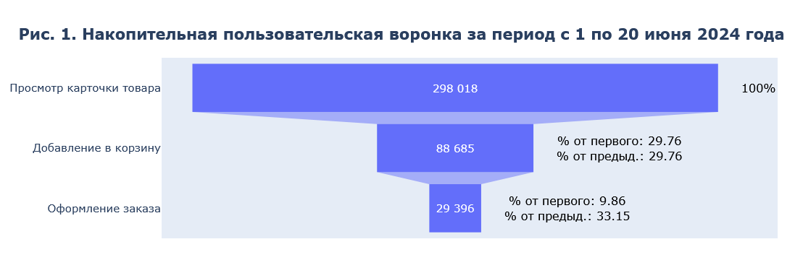
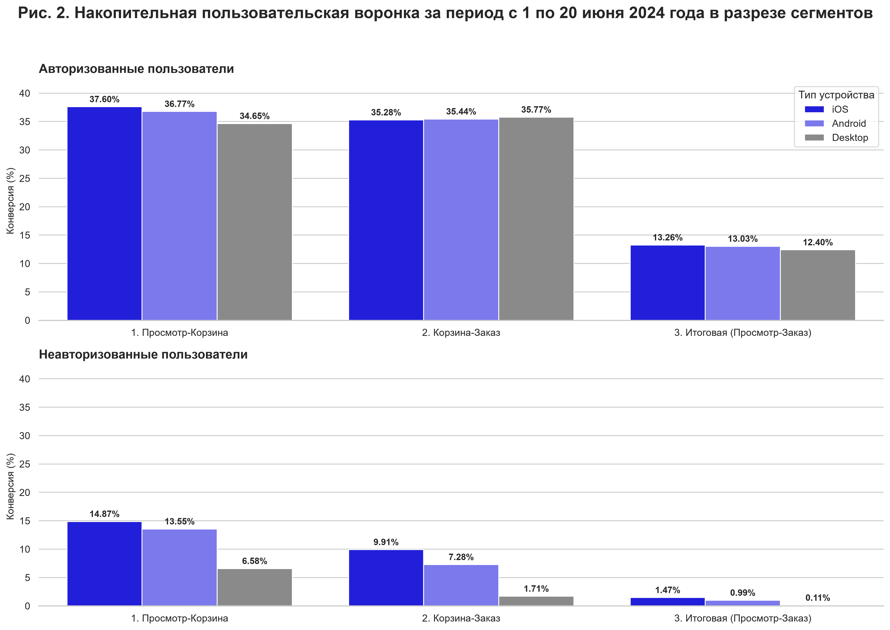

# **Поиск точек роста конверсии и анализ упущенной выручки интернет-магазина**

**[Открыть Jupyter Notebook с кодом и графиками](ecommerce-funnel-optimization.ipynb)**

## Содержание
1. [Краткое резюме](#1-краткое-резюме)
2. [Результаты](#2-результаты)
3. [Рекомендации, продуктовые гипотезы и упущенная выручка](#3-рекомендации-продуктовые-гипотезы-и-упущенная-выручка)
4. [Данные](#4-данные)
5. [Методология](#5-методология)
6. [Ограничения](#6-ограничения)
7. [Стек](#7-стек)

## 1. Краткое резюме

В рамках проекта проведен анализ логов взаимодействия пользователей с диджитал-каналами магазина (мобильное приложение, сайт) за период с 1 по 20 июня 2024 года.

**Цели:** 
- выявить крупный пользовательский сегмент с наиболее выраженным отставанием конверсии и этап воронки, где данное отставание критическое;
- предложить гипотезы о причинах отставания;
- рассчитать упущенную магазином выручку.

## 2. Результаты

**Наблюдения по воронке:**

- На рис. 1 видно, что за исследуемый период карточки товаров просмотрели 298 018 уникальных пользователей, из них только 9,86% дошли до этапа оформления заказа.
- **Наибольшие потери пользователей (70,24%) наблюдаются на первом шаге воронки**, т.е. при переходе от просмотра карточки товара к его добавлению в корзину, **что нормально для электронной коммерции**, т.к. перед покупкой люди обычно присматриваются к товарам, сравнивают их, изучают отзывы.

**Табл. 1. Коэффициент ухудшения конверсии (Авторизованные / Неавторизованные) [^1]:**

| Тип устройства | Шаг 1: Просмотр-Корзина | Шаг 2: Корзина-Заказ | Итоговая конверсия: Просмотр-Заказ |
| -------------- | ----------------------- | --------------------- | -------------------------------- |
| iOS            | в 2,53 раза             | в 3,56 раза           | в 9,02 раза                      |
| Android        | в 2,71 раза             | в 4,87 раза           | в 13,16 раза                     |
| **Desktop**    | **в 5,27 раза**         | **в 20,92 раза**       | **в 112,73 раза**                |

**Наблюдения по воронке в разрезе сегментов:**

- На рис. 2 видно, что конверсии авторизованных пользователей в разрезе устройств находятся примерно на одном уровне внутри каждого этапа воронки.
- У неавторизованных пользователей худшая конверсия на Desktop на всех этапах воронки, а у неавторизованных пользователей мобильных устройств конверсии внутри каждого этапа воронки не сильно отличаются друг от друга.
- Из табл. 1 можно сделать вывод, что **конверсия неавторизованных пользователей Desktop хуже авторизованного Desktop сегмента** в 5,27 раза на первом шаге, и **в 20,92 раза - на втором шаге**.

[^1]: коэффициент показывает, во сколько раз конверсия неавторизованных пользователей хуже, чем у авторизованных.

**Табл. 2. Абсолютные потери в разрезе сегментов:**

| Сегмент                                   | Просмотрели товар | Оформили заказ | Итоговая конверсия | Абсолютные потери |
| ----------------------------------------- | ----------------- | -------------- | ------------------ | ----------------- |
| Авторизованные пользователи Android       | 127 187           | 16 575         | 13,03%             | 110 612           |
| Авторизованные пользователи iOS           | 81 663            | 10 832         | 13,26%             | 70 831            |
| **Неавторизованные пользователи Desktop** | 55 246            | 62             | **0,11%**          | **55 184**        |
| Авторизованные пользователи Desktop       | 17 481            | 2 167          | 12,40%             | 15 314            |
| Неавторизованные пользователи Android     | 13 988            | 138            | 0,99%              | 13 850            |
| Неавторизованные пользователи iOS         | 11 806            | 174            | 1,47%              | 11 632            |

**Приоритизация сегментов с учетом абсолютных потерь:**

Из табл. 2 видно, что наибольшие абсолютные потери от просмотра карточки товара до оформления заказа наблюдаются у авторизованных пользователей Android: 110 612 пользователей. Однако конверсия этого сегмента составляет 13,03% и практически совпадает с конверсией авторизованных пользователей iOS - 13,26%. Поэтому большой объем потерь в первую очередь связан с размером сегмента.

Авторизованные пользователи iOS находятся на втором месте по потерям, но здесь большой объем потерь так же объясняется размером сегмента при его конверсии в 13,26%.

У неавторизованных пользователей Desktop до создания заказа не дошли 55 184 пользователя. Это третье место по потерям. Итоговая конверсия сегмента составляет 0,11% против 0,99% на Android и 1,47% на iOS среди неавторизованных пользователей.

Следовательно, неавторизованные пользователи Desktop выбраны для дальнейшей диагностики не потому, что этот сегмент имеет максимальные абсолютные потери, а потому, что он сочетает значительный размер аудитории с наиболее выраженным отставанием конверсии.

## 3. Рекомендации, продуктовые гипотезы и упущенная выручка

**Рекомендации:** 
- **приоритизировать работу с неавторизованными пользователями Desktop** из-за сочетания значительного размера сегмента и наиболее выраженного отставания конверсии.
- **сфокусироваться на этапе Корзина-Заказ**, потому что отставание от авторизованных в 5,27 раза на первом шаге (Просмотр-Корзина) некритично, т.к. на Desktop заходит много «холодного» поискового трафика (SEO/контекст), который использует большой экран просто для сравнения характеристик, чтения отзывов или проверки наличия товара. В приложение же обычно идут целевые пользователи, которые уже скачали его и настроены на покупку. А отставание от авторизованных в 20,92 раза на втором шаге (Корзина-Заказ) уже критично, потому что здесь неавторизованный пользователь выразил намерение, положил товар в корзину, но не оформил заказ по каким-то причинам. Или же перешел в статус авторизованных пользователей. 

**Продуктовые гипотезы:**
1. **Принудительная авторизация**. Попав в корзину, неавторизованные пользователи Desktop видят перед собой всплывающее окно с сообщением о необходимости авторизации при попытке перехода к оформлению заказа. Пользователям лень ждать СМС с кодом подтверждения, либо СМС до них не доходит по каким-либо причинам.
- **Решение:** внедрить гостевой чекаут (оформление заказа без обязательной регистрации), создавая личный кабинет автоматически в фоновом режиме после оплаты.
2. **Техническая ошибка**. На десктопной версии сайта для неавторизованных пользователей некорректно работает сохранение состояния корзины при переходе между страницами или вкладками. При попытке перехода к оформлению заказа корзина пользователя очищается, что заставляет его покинуть сайт.
- **Решение:** зайти на сайт магазина с ПК в режиме инкогнито из браузеров, популярных среди клиентов магазина (например, Яндекс Браузер, Chrome, Safari), добавить товар, перейти в корзину и попробовать оформить заказ. Если корзина очищается, то тогда передать данную проблему в работу разработчикам.

**Упущенная выручка:**
- **3 557 458,60 руб.**[^2] магазин недополучил за 20 дней.

[^2]: детали расчета см. подробнее в разделе [Методология](#5-методология), пункты 11 и 12.

## 4. Данные

 [Посмотреть полное описание данных](dataset-description.pdf)
 
- **Источник:** [DANO 2024 - SM Lab: воронка онлайн-продаж](https://dano.hse.ru/data2024)
- **Название датасета:** sm_small_random.csv
- **Размерность исходного датасета:** 996 899 строк и 18 столбцов
- **Период исходных данных:** 1-21 июня 2024 года
- **Единица наблюдения:** событие просмотра карточки товара

**Табл. 3. Проверка качества данных:**

| Проверка              | Результат           | Решение                                                                                                                                                   |
| --------------------- | ------------------- | --------------------------------------------------------------------------------------------------------------------------------------------------------- |
| Дубликаты событий     | 4 строки            | Удалены полные дубликаты строк                                                                                                                            |
| Неполный день         | 21 июня 2024        | Исключен из анализа                                                                                                                                       |
| Логика воронки        | 0 нарушений         | Заказов без добавления в корзину не обнаружено                                                                                                            |
| Аномальная активность | 0,13% пользователей | Проверка устойчивости показала, что исключение аномально активных пользователей меняет итоговую конверсию всего на 0,06 п.п. Решено оставить их в выборке |

## 5. Методология

1. **Определение воронки:** накопительная пользовательская воронка за период с 1 по 20 июня 2024 года включительно.
2.  **Этапы воронки:** 
	1. клик (просмотр) на карточку товара (`event_id`)
	2. добавление в корзину (`add_to_cart_flag`)
	3. оформление заказа (`create_order_flag`).
3. **Логика построения воронки:** данные агрегированы на уровне уникальных пользователей (`user_id`). Пользователь считается достигшим этапа, если соответствующий флаг зафиксирован у него хотя бы 1 раз за исследуемый период (20 дней). Такой подход позволяет оценить итоговую конверсию пользователей за период и исключает искажение метрики из-за высокой частоты повторных действий отдельных пользователей.
4. **Формула расчета итоговой конверсии:** (количество уникальных пользователей, оформивших заказ / количество уникальных пользователей, просмотревших карточки товаров) * 100%.
5. **Формула расчета межэтапной конверсии:** (количество уникальных пользователей на текущем этапе воронки / количество уникальных пользователей на предыдущем этапе воронки) * 100%.
6. **Терминология:**
	1. вместо термина «сквозная конверсия» в проекте используется термин «итоговая конверсия», т.к. анализ проводится внутри одного продуктового датасета без привлечения данных из внешних маркетинговых или финансовых систем (CRM).
 	2. «пользователь в сегменте» - это «пара пользователь-устройство»[^3].
7. **Определение аномалий:** пользователи, совершившие более 21 просмотра в один активный пользовательский день.
8. **Обоснование порога фильтрации (> 21 просмотра):** на основе анализа распределения просмотров по перцентилям зафиксировано, что 99,9% активных пользовательских дней содержат не более 21 просмотра. Данное значение принято в качестве границы нормальной пользовательской активности.
9. **Сегментация:** 
	1. по типу устройства (`device_type`: Android, iOS, Desktop)
	2. по статусу авторизации (`user_is_authorized`: 1 - авторизован, 0 - не авторизован)
	3. перекрестная сегментация (тип устройства + статус авторизации).
	4. проверены переходы пользователей между статусами авторизации и устройствами.
10. **Логика приоритизации:** сегменты сравниваются одновременно по конверсии, размеру сегмента и абсолютному числу пользователей, не достигших следующего этапа в воронке. Низкая конверсия сама по себе не означает наибольший потенциальный эффект.
11. **Формула расчета упущенной выручки:** (количество потенциальных заказов сегмента - количество текущих заказов в сегменте) * средняя выручка на одного платящего пользователя[^4]
12. **Логика расчета количества потенциальных заказов:** в рамках консервативного сценария в качестве ориентира была взята итоговая конверсия в 0,99% (текущий уровень неавторизованных пользователей Android). Это минимальный и легкодостижимый порог при устранении барьеров на Desktop, т.к. он не учитывает еще более высокую конверсию сегмента iOS (1,47%).

[^3]: подробнее в разделе [Ограничения](#6-ограничения), пункт 3.
[^4]: см. раздел [Ограничения](#6-ограничения), пункт 4.

## 6. Ограничения

1. **Короткий период наблюдения:** за 20 дней невозможно оценить сезонность и долгосрочную устойчивость результатов.
2. **Отсутствие сессионных данных:** без идентификатора сессий (`session_id`) и таймстемпов (`create_timestamp`) для промежуточных шагов (корзина, заказ) невозможно узнать последовательность действий пользователей внутри одной сессии и проанализировать пользовательский путь. Классическая сессионная воронка не может быть построена.
3. **Пересечение сегментов:** из-за отсутствия сессионных данных и группировки по идентификаторам пользователей (`user_id`), статусу авторизации (`user_is_authorized`) и типу устройства (`device_type`) при построении воронки один и тот же пользователь может попасть в несколько сегментов и поэтому количество пользователей будет завышено. Проверка пересечений сегментов показала, что 3 517 (~1,18%) пользователей меняли статус авторизации, а 5 955 (~2%) - заходили с разных устройств. Следовательно, конверсии в неавторизованных сегментах могут быть немного занижены.
4. **Отсутствие данных о заказах:** без идентификатора заказа (`order_id`) невозможно посчитать средний чек для оценки упущенной выручки. Поэтому вместо среднего чека была взята средняя выручка на одного платящего пользователя.
5. **Наблюдательные результаты анализа:** не позволяют делать причинно-следственные выводы без дополнительных экспериментов (A/B-тестов) или более подробных поведенческих данных.
6. **Неизвестная репрезентативность выборки:** способ формирования выборки не описан в источнике данных, поэтому непонятно, насколько точно она отражает поведение всех пользователей в диджитал-каналах магазина.

## 7. Стек

`SQL` `DuckDB` `Python` `pandas` `Plotly` `Matplotlib` `seaborn` `gdown` `Jupyter Notebook`
